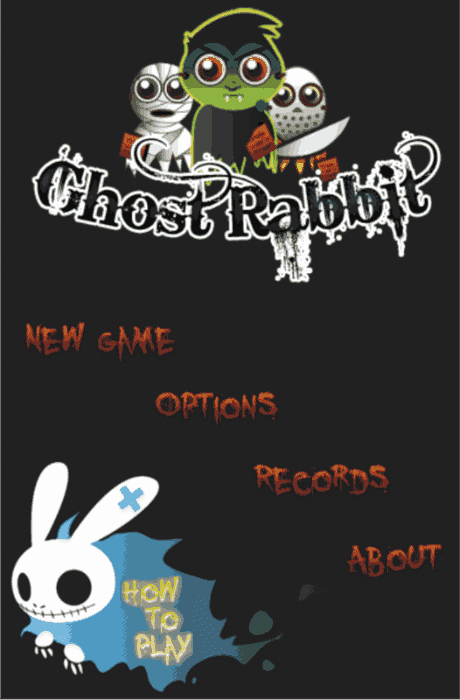

# Ghost Rabbit
[Ghost Rabbit](https://xcemaxx.github.io/ghost_rabbit_ai) is a 2D game like doodle jump. Used WASM and macroquad.

There is legacy C# XNA version: https://github.com/XCemaXX/ghost_rabbit_ai/tree/master/legacy

Check runnable version online: [Ghost Rabbit](https://xcemaxx.github.io/ghost_rabbit_ai)
The game needs WebAssembly SIMD: Chrome 91+, Firefox 89+, Safari 16.4+ (iOS 16.4+).

# Building and running
The build is in release mode by default. Pass `--dev` for a debug build.
- Add the target: `rustup target add wasm32-unknown-unknown`
- Optional: put `wasm-opt` from [binaryen](https://github.com/WebAssembly/binaryen/releases) in `PATH`. The release build uses it to make the wasm smaller.
- Build: `./gui/build.sh`
- Run server: `cd gui && python3 -m http.server 7002`
- Open site: http://localhost:7002
- After a macroquad update, copy `js/mq_js_bundle.js` from the macroquad repository (same tag) to `gui/pkg/`.
- After a sapp-jsutils update, copy `js/sapp_jsutils.js` from the crate (same version as in `Cargo.lock`) to `gui/pkg/`.
  The macroquad bundle does not export `js_object` globally, and `quad_storage.js` needs it.

Native tests on Linux need ALSA headers: `sudo apt install libasound2-dev`. Then run `cargo test --workspace`.

# Show
[Check by yourself online](https://xcemaxx.github.io/ghost_rabbit_ai)  

# AI
The AI button in the main menu starts a bot. It plays Unreal and starts again after each death.
The bot sees only the screen. How it is built and trained: `docs/ai_research.md`.
Retrain the weights in `resources/bot/`: `cargo run --release -p bot_train`.